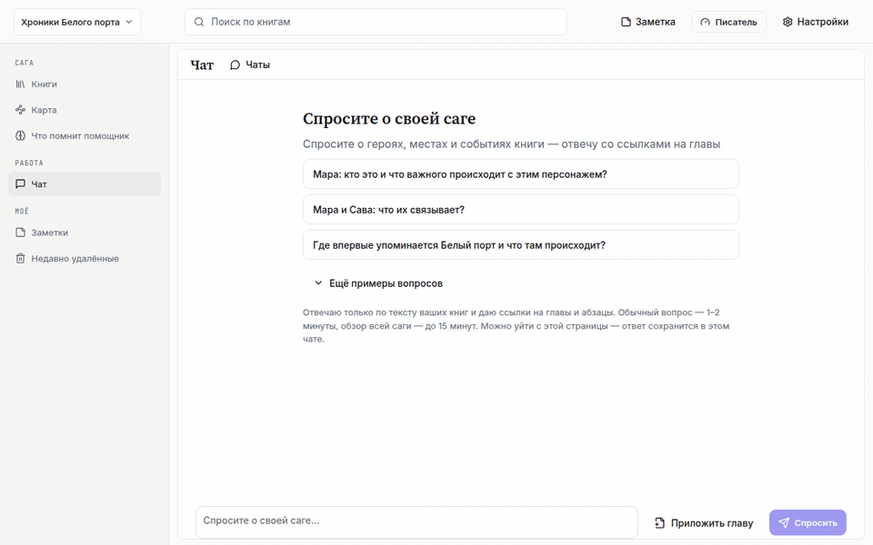
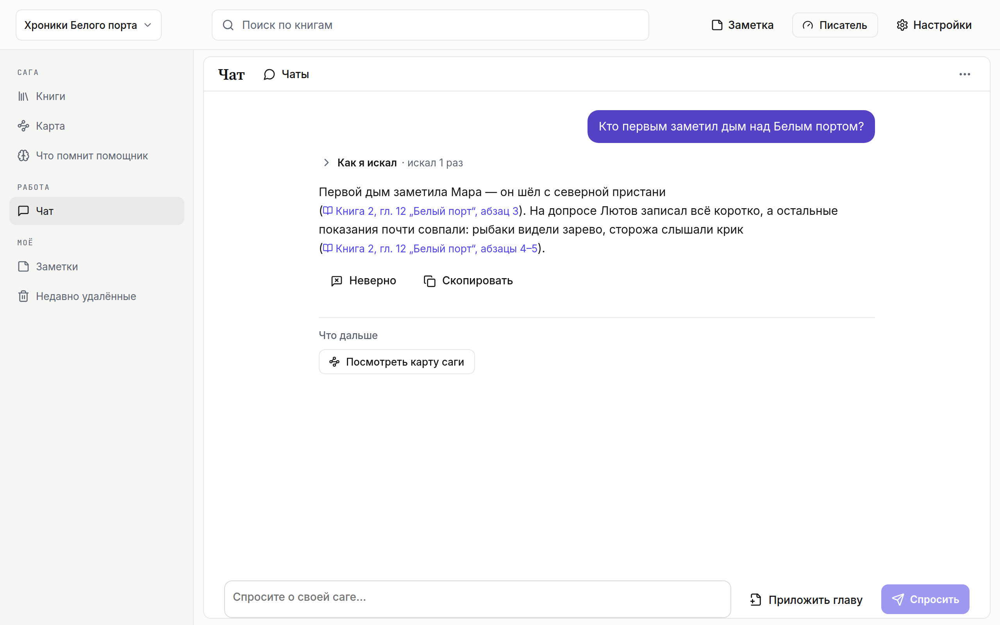
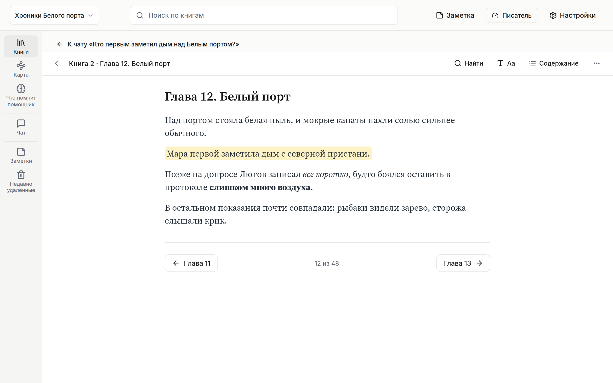
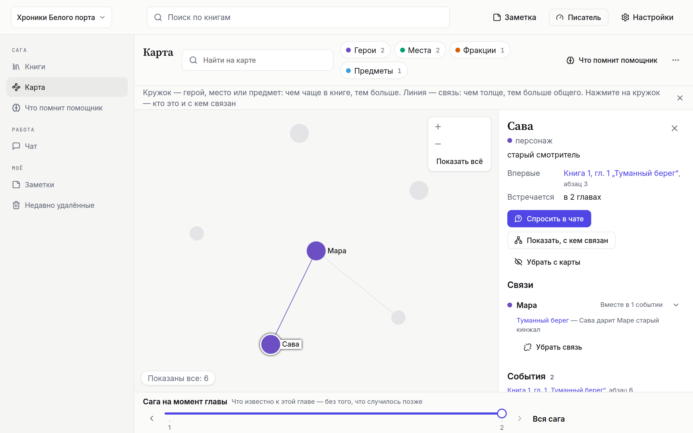
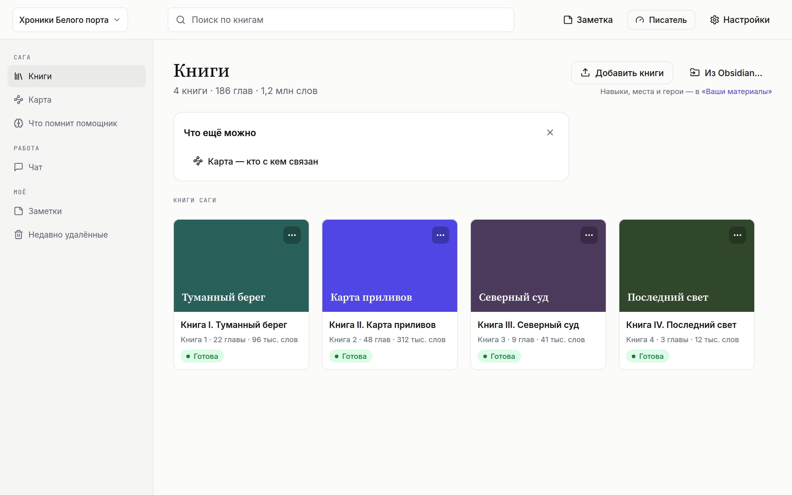

# CanonKeeper — помощник писателя, который помнит вашу сагу

Вы пишете большую историю: десятки глав, сотни героев, мест и событий. CanonKeeper сам прочитает ваши книги и будет
отвечать на вопросы о них — со ссылкой на главу и абзац, где это сказано.

> «В какой главе Мара впервые увидела маяк?» · «Что Тихон знает о письме к этому моменту?» ·
> «Где я уже описывал северный перевал?» · «Как звали капитана парома?»

Это приложение для компьютера: книги и всё, что помощник о них знает, лежат у вас, а не в интернете.

**[Скачать CanonKeeper](https://canonkeeper.ru/desktop)** — для Windows и Linux, бесплатно.

<p align="center">
  
</p>
<p align="center"><sub>Вопрос — ответ со ссылками на главу и абзац — книга открывается на этом месте. На примере тестовой
саги «Хроники Белого порта».</sub></p>

## Что он умеет

- **Отвечает на вопросы по вашим книгам.** Спрашивайте обычными словами — помощник найдёт нужные места во всех книгах
  саги и ответит со ссылками; ссылка открывает книгу на этом абзаце.
- **Строит карту саги.** Герои, места и их связи — по тому, что написано в книгах, с главами, где они появляются.
- **Помнит, что вы ему сказали.** Поправки («Тихону здесь 40, а не 30») и планы на будущие главы — помощник учитывает
  их в ответах и не выдаёт план за то, что уже есть в книге.
- **Читалка и поиск.** Все книги саги в одном месте, поиск по тексту всех томов, заметки на полях.
- **Дружит с Obsidian.** Книги и записи можно взять из хранилища Obsidian, а карту саги — выгрузить туда.
- **Принимает книги как есть:** `.fb2`, `.epub`, `.docx`, `.txt`, `.md`, `.rtf`, `.odt`, `.fb2.zip`.

## Как это выглядит

<table>
  <tr>
    <td width="50%"><br><sub>Ответ со ссылками на главы и абзацы</sub></td>
    <td width="50%"><br><sub>Ссылка открывает книгу на нужном абзаце</sub></td>
  </tr>
  <tr>
    <td width="50%"><br><sub>Карта саги: герои, места и связи</sub></td>
    <td width="50%"><br><sub>Все тома саги в одном месте</sub></td>
  </tr>
</table>

## С чего начать

1. **Установите** приложение со страницы [canonkeeper.ru/desktop](https://canonkeeper.ru/desktop).
2. **Добавьте книги** — назовите сагу и перетащите файлы томов, по порядку.
3. **Подключите помощника** одним из двух способов:
   - **Аккаунт CanonKeeper** — войдите тем же аккаунтом, что на сайте, и помощник работает по вашему тарифу.
     Настраивать ничего не нужно.
   - **Свой помощник** — если у вас есть доступ к своему провайдеру, укажите его адрес: тариф CanonKeeper не тратится.
4. **Спрашивайте.** Пока помощник читает книги, читать, искать и делать заметки можно сразу.

Уже работаете на сайте [canonkeeper.ru](https://canonkeeper.ru)? Сагу оттуда можно перенести в приложение одним
файлом: на сайте нажмите название саги вверху → «Настроить сагу» → «Скачать сагу файлом…», затем в приложении —
«Открыть файл саги…». Книги и всё, что помощник о них знает, переедут целиком.

## Ваши книги остаются у вас

Книги, главы, чаты и заметки хранятся на вашем компьютере. Помощнику уходит только то, что нужно для ответа, — ваш
вопрос и места книг, которые он читает. Каждую отправку видно в «Настройках → Журнал».

## Почему Windows предупреждает при установке

У CanonKeeper нет платной цифровой подписи: программа бесплатная, её код открыт. Поэтому при установке Windows покажет
окно «Система Windows защитила ваш компьютер» — нажмите «Подробнее», затем «Выполнить в любом случае». Обновления из
самого приложения этого окна не показывают.

Если CanonKeeper не запускается на Windows 11, проверьте «Безопасность Windows → Управление приложениями и браузером →
Интеллектуальное управление приложениями»: при «Вкл.» программа не запустится. Антивирус может принять новую программу
без подписи за подозрительную — тогда проверьте его карантин. Книги при этом остаются на компьютере.

## Какие системы подходят

| Система | Что скачать |
|---|---|
| Windows 10 (1903) и новее, 64 бит | установщик `.exe` — ставится без прав администратора |
| Ubuntu 24.04, Debian 13 и новее | пакет `.deb` |
| Fedora 42 и новее | пакет `.rpm` |
| Любой другой Linux | `AppImage` |

Приложение само проверяет обновления раз в день и ставит их по кнопке «Обновить и перезапустить». Все версии — на
странице [выпусков](https://github.com/canonkeeper/desktop-app/releases).

Вопросы и предложения — через «Написать нам» на [canonkeeper.ru](https://canonkeeper.ru).

---

## Для разработчиков

Здесь — открытый код приложения CanonKeeper для Windows и Linux. Код сюда выгружается из основного репозитория проекта
по манифесту.

<details>
<summary>Сборка, проверка файлов, данные, лицензии</summary>

### Сборка

Нужны Go (версия — в `backend/go.mod`), Node.js (`.node-version`) и Rust; подробно — в
[`desktop/README.md`](desktop/README.md).

```sh
npm ci
(cd backend && go test ./...)          # тесты PostgreSQL пропускаются без CANONKEEPER_TEST_DATABASE_URL
npm run test && npm run typecheck:desktop
(cd desktop/src-tauri && cargo test -p canonkeeper-desktop-core)
```

Установщики собирает публичный CI этого репозитория (`.github/workflows/desktop-build.yml`); выпуск — метка `vX.Y.Z`,
его подписывает и публикует владелец.

### Проверить файлы выпуска

В каждом выпуске — `SHA256SUMS` и его подпись `SHA256SUMS.sig` (minisign в обёртке base64, как у обновлений Tauri;
открытый ключ — `plugins.updater.pubkey` в `desktop/src-tauri/tauri.conf.json`), и свидетельство сборки GitHub:

```sh
sha256sum -c SHA256SUMS --ignore-missing
gh attestation verify CanonKeeper_<версия>_x64-setup.exe -R canonkeeper/desktop-app
```

Сайт держит копию выпуска (`https://canonkeeper.ru/app/open/<версия>/…`) и открывает её, только проверив подписи.

### Где лежат данные

Windows — `%LOCALAPPDATA%\ru.canonkeeper.desktop\data`, Linux — `~/.local/share/canonkeeper`. Удаление программы на
Windows спрашивает, удалить ли и данные (по умолчанию — нет); «Настройки → Данные → Стереть все данные…» удаляет всё,
что приложение хранит на компьютере. Как вернуться на прежнюю версию — в
[`desktop/README.md`](desktop/README.md#вернуться-на-прежнюю-версию).

### Лицензии

- Код этого репозитория — [GNU AGPL-3.0-only](LICENSE); новые файлы несут заголовок
  `SPDX-License-Identifier: AGPL-3.0-only`.
- `translate/` и `spike/translate` — код codex-lb под MIT: «Copyright (c) 2025 Soju06» и, для частей из
  codex-relay, «Copyright (c) 2025 Sapient Inc.» (см. их `NOTICE`).
- `codex-app-server` берётся из релиза форка Codex (Apache-2.0) и в репозиторий не входит.
- PostgreSQL собирается из исходного архива (PostgreSQL License).
- Лицензии зависимостей Go, npm и Rust совместимы с AGPL-3.0; «CanonKeeper» и логотип — только для сборок владельца,
  форки меняют имя.

### Участникам

Перед каждым push работает проверка запрещённого содержимого (`scripts/check-forbidden.py`): секреты, внешние адреса,
домашние каталоги, чужие почтовые адреса и совпадения с закрытым репозиторием. Включить её как хук:
`git config core.hooksPath scripts/hooks`. Приём внешних изменений (CLA) появится позже.

</details>
